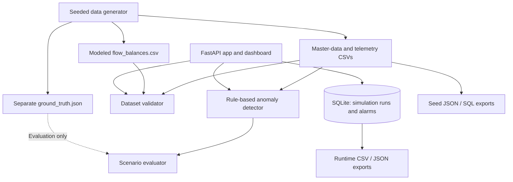

# IndustrialPulse AI

**A reproducible synthetic industrial-monitoring prototype for validating asset data, screening telemetry anomalies, and tracking pump-speed simulations.**

IndustrialPulse AI is a reproducible industrial-monitoring prototype that combines synthetic asset data generation, telemetry validation, explainable anomaly screening, and traceable pump-speed simulations. Built with Python, FastAPI, and SQLite, it provides an end-to-end workflow for exploring equipment data quality, screening abnormal patterns, evaluating scenarios, and inspecting simulation results.

> **Scope:** This is an educational prototype. It is not an industrial control system, a validated hydraulic simulator, or a safety-certified product.

## Highlights

- **Deterministic data generation** using a configurable seed.
- **Synthetic industrial master data:** facilities, pumps, tanks, valves, pipes, sensors, operating modes, and telemetry.
- **Data validation** for identifiers, relationships, topology, units, bounds, timestamps, sensor metadata, and modeled flow-balance inputs.
- **Explainable anomaly screening** for pump degradation, sensor faults, low-flow/leak proxies, and pressure/blockage proxies.
- **Scenario evaluation** using ground-truth labels kept separate from detector input.
- **Pump-speed simulation** using a documented pump-affinity-law approximation.
- **FastAPI dashboard and API** with SQLite persistence for simulation runs and alarms.
- **Exports** for generated master data and persisted runtime records.
- **Reproducibility checks** based on record counts and SHA-256 checksums.
- **Automated tests** for core logic, validation, API behavior, and exports.

## Current synthetic dataset

The default full dataset uses seed `20261022` and contains:

| Data | Count |
|---|---:|
| Facilities | 3 |
| Pumps | 20 |
| Tanks | 30 |
| Valves | 60 |
| Pipes | 107 |
| Sensors | 53 |
| Operating modes | 3 |
| Telemetry records | 100,000 |
| Modeled flow-balance intervals | 9 |

These are generated prototype records, not measurements from a real plant. The generator can produce a smaller telemetry dataset for faster local development.

## Architecture



The detector does not receive scenario labels. The evaluator compares detections with ground truth after detection has run. Flow-balance records are generated as a separate modeled artifact; they are not derived from synchronized telemetry.

## Technology stack

| Technology | Purpose |
|---|---|
| Python | Application logic and scripts |
| Pandas, NumPy | Synthetic data generation and tabular processing |
| FastAPI, Pydantic | HTTP API and request validation |
| SQLite | Local persistence |
| pytest, HTTPX | Automated tests |
| HTML, CSS, JavaScript | Browser dashboard |

## Repository layout

```text
app/
  engine.py             Rule-based detection
  exports.py            Seed and runtime export functions
  generator.py          Deterministic data and scenario generation
  main.py               API, dashboard, SQLite schema, simulation workflow
  validation.py         Dataset, balance, and simulation-record validation
scripts/
  export_data.py        Export command-line interface
  reproducibility_check.py
tests/
  fixtures/
  test_core.py
  test_validation.py
  test_api_exports.py
docs/
  architecture.md
  data_dictionary.md
  simulation_assumptions.md
  ai_usage/
generate_data.py
evaluate_scenarios.py
requirements.txt
pytest.ini
```

Generated files are written to `data/generated/` by default and are ignored by Git. Generate them locally after checkout.

## Getting started

### 1. Requirements

- Python 3.10 or newer
- `pip`

### 2. Create a virtual environment

**Windows PowerShell**

```powershell
python -m venv .venv
.\.venv\Scripts\Activate.ps1
python -m pip install -r requirements.txt
```

**macOS / Linux**

```bash
python3 -m venv .venv
source .venv/bin/activate
python -m pip install -r requirements.txt
```

### 3. Generate the dataset

Generate the default dataset:

```bash
python generate_data.py --seed 20261022 --telemetry 100000
```

For a smaller dataset during development:

```bash
python generate_data.py --seed 20261022 --telemetry 2000
```

The generator writes entity CSV files, `flow_balances.csv`, `ground_truth.json`, `validation_summary.json`, and `source_manifest.json` under `data/generated/` by default. Use `--output-dir` to choose another destination. The manifest records the seed, record count, synthetic-data provenance, and SHA-256 checksums for generated outputs (excluding the manifest itself).

### 4. Validate the generated dataset

```bash
python -c "from app.validation import validate_dataset; import json; print(json.dumps(validate_dataset('data/generated'), indent=2))"
```

### 5. Evaluate scenarios and run tests

```bash
python evaluate_scenarios.py
python -m pytest -q
```

### 6. Check reproducibility

```bash
python scripts/reproducibility_check.py --seed 20261022 --telemetry 100000
```

The reproducibility script generates outputs in two fresh temporary directories and compares record counts and SHA-256 checksums. This checks repeatability for the selected seed, dataset size, code, and environment; it does not prove that the model represents real plant behavior.

## Run the API and dashboard

From the repository root, start the local server:

```bash
uvicorn app.main:app --reload
```

Open the dashboard at `http://127.0.0.1:8000/` and the interactive API documentation at `http://127.0.0.1:8000/docs`.

The app may generate a smaller 5,000-row dataset when the dashboard is opened and telemetry is missing. Generate the full baseline first if you want to work with the 100,000-row dataset.

### API endpoints

| Method | Endpoint | Behavior |
|---|---|---|
| `GET` | `/` | Serves the browser dashboard |
| `GET` | `/api/summary` | Returns counts and the current dataset validation result |
| `GET` | `/api/telemetry?limit=100` | Returns telemetry records; limit is clamped to 1–5,000 |
| `GET` | `/api/alarms` | Runs detection, persists unseen alarm records, and returns persisted alarms |
| `POST` | `/api/simulations` | Validates and executes a pump-speed estimate, then persists the run |
| `GET` | `/api/simulations` | Returns simulation history, newest first |

### Example pump-speed simulation

Request:

```json
{
  "pump_id": "PUMP-001",
  "speed_pct": 80,
  "seed": 20261022
}
```

`speed_pct` must be finite and between `10` and `120`. `seed` must be a non-negative integer. Unknown pump IDs return `404`; malformed or out-of-range requests return `422`.

The response includes a simulation-run ID, configuration, configuration hash, status, and predicted output. Exact output values depend on the generated master data and configuration.

## Detection and scenario evaluation

The prototype implements illustrative, rule-based screening:

| Scenario | Simplified rule | What the result means |
|---|---|---|
| Pump degradation | Flow below 75% of pump nominal for at least 10 consecutive good readings | Pump-level screening alarm |
| Sensor fault | At least 8 consecutive identical readings, or a negative physical reading | Sensor-quality alarm |
| Leak | At least 10 low normalized-flow readings below 75% nominal across at least 3 facility pump sensors | Facility-level low-flow proxy |
| Blockage | Pressure above 110% of the sensor's first 20 good readings for at least 10 readings | Facility-level pressure anomaly |

Ground-truth scenario labels are used by the evaluator, not supplied to the detector. Sensor readings marked `suspect` are excluded from process rules, and detected sensor-fault windows are excluded from pressure/flow process screening.

In the documented synthetic evaluation, four scenario outcomes were reported: two exact target matches (pump degradation and sensor fault) and two facility-level proxies (leak and blockage). There were zero missed and zero unexpected outcomes **for that synthetic run only**. These counts are not precision, recall, F1, or evidence of real-world detection accuracy.

## Pump simulation and flow-balance model

### Pump-speed approximation

The pump simulation uses a simplified affinity-law approximation:

```text
predicted flow = nominal flow × (speed_pct / 100)
predicted head = shutoff head × (speed_pct / 100)²
```

It estimates pump-level behavior only. It does **not** solve a hydraulic network operating point.

### Modeled flow balance

For each interval, the validator calculates:

```text
residual (L/s) =
    sum(inlet flows (L/s))
  - sum(outlet flows (L/s))
  - tank volume change (L) / interval duration (s)
```

The accepted condition is `abs(residual) <= 8 L/s`. The generated baseline contains three modeled operating points per facility at demand factors `0.50`, `0.75`, and `1.00`, for nine intervals total. The model assumes steady state and zero tank-volume change and derives throughput from nominal pump capacities.

These values are **modeled outputs, not measured flows**. They are separate from telemetry and do not establish physical flow conservation or validate the generated topology.

## Data exports

### Export generated seed data

```bash
python scripts/export_data.py \
  --data-dir data/generated \
  --seed-json exports/seed_data.json \
  --seed-sql exports/seed_data.sql
```

The JSON and SQL exports contain the eight entity/telemetry tables. The modeled `flow_balances.csv` is not included in those seed exports. The SQL script can be imported into SQLite and includes relational constraints.

### Export runtime simulation runs and alarms

Create runtime records through the API first, then run:

```bash
python scripts/export_data.py \
  --database industrialpulse.db \
  --simulation-exports exports
```

This writes `simulation_runs.csv`, `simulation_runs.json`, `alarms.csv`, and `alarms.json` from the existing database. Runtime exports do not delete or overwrite database history.

For all command-line options, run:

```bash
python scripts/export_data.py --help
```

## Verification

The documented verification pass reported:

- `python -m pytest -q`: **29 passed**, with one third-party AnyIO/pytest deprecation warning.
- `python -m compileall -q app scripts tests`: passed.
- Generator, export, and reproducibility CLI help checks: passed.
- `git diff --check` and Markdown table/link/anchor checks: passed.
- Scenario evaluation: four outcomes—two exact target matches and two facility-level proxies—in the evaluated synthetic run.
- Baseline validation: 100,000 telemetry rows, expected master-data counts, zero validation errors, and nine modeled flow-balance intervals.
- A full-scale reproducibility check passed in an earlier run; it was **not rerun during the documentation pass**.

These are recorded results from a specific development environment, not guarantees for other dependency versions or production conditions. Re-run the commands above to verify your checkout.

## Limitations

- All master data, telemetry, and scenarios are synthetic; they are not validated representations of a real plant.
- Telemetry rows are sensor records and do not provide synchronized network-boundary measurements.
- Flow-balance values are derived from nominal pump capacities, not physical measurements.
- The generated pipe topology is simplified, and no hydraulic network solver is implemented.
- Leak and blockage results are facility-level proxies; exact pipe blockage localization is not implemented.
- Detection thresholds are illustrative and are not calibrated operational limits.
- Runtime alarm records do not retain all detector sensor/time-window details, and alarm acknowledgement/resolution lifecycle is not implemented.
- The project does not provide production authentication, deployment, backup, or safety controls.

## Documentation

- [Architecture and high-level design](docs/architecture.md)
- [Data dictionary and validation schemas](docs/data_dictionary.md)
- [Simulation assumptions and thresholds](docs/simulation_assumptions.md)
- [AI contribution statement](docs/ai_usage/ai_contribution_statement.md)
- [AI prompt history](docs/ai_usage/prompt_history.md)

---

**Built as a reproducible engineering prototype:** synthetic data generation, validation, explainable screening, traceable simulation records, and documented limitations.
