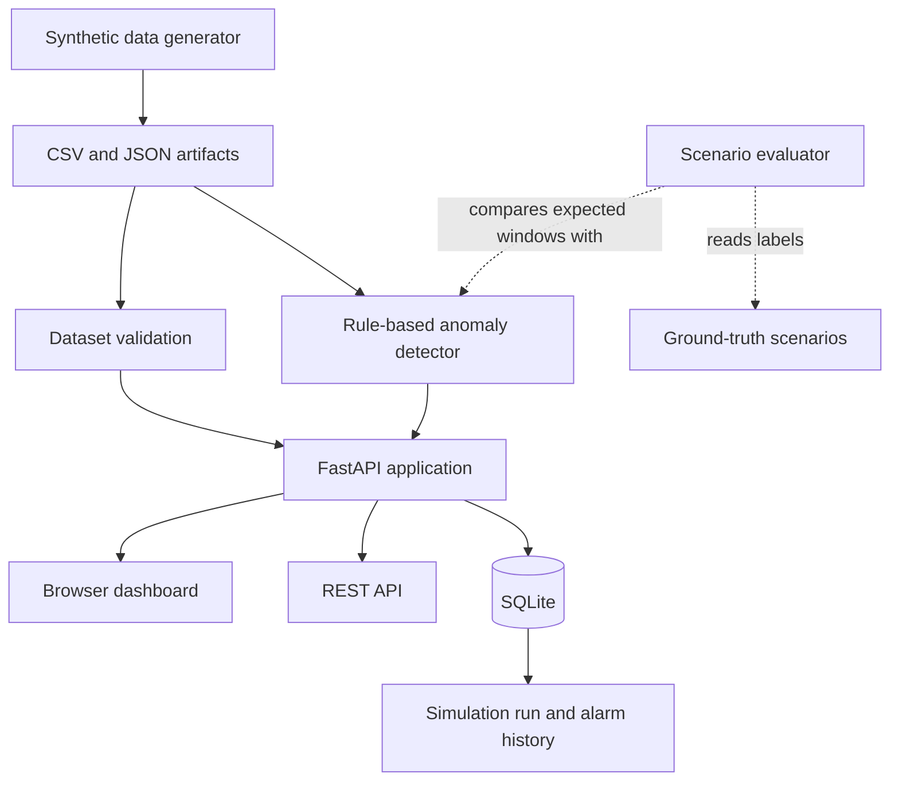

# IndustrialPulse AI

**A local industrial-monitoring prototype for synthetic telemetry, explainable anomaly detection, and traceable simulation workflows.**

**Status:** Prototype / demo  
**Stack:** Python · FastAPI · SQLite · Pandas · NumPy · NetworkX · pytest

> IndustrialPulse AI demonstrates a compact end-to-end monitoring workflow using synthetic industrial data. It is intended for learning, evaluation, and reproducible experimentation—not for live plant operations or safety-critical decisions.

## Overview

IndustrialPulse AI models a synthetic industrial environment containing facilities, pumps, tanks, valves, pipes, and sensors. It generates telemetry, validates data relationships, applies explicit anomaly-detection rules, exposes results through a FastAPI service and browser dashboard, and stores simulation runs and alarms in SQLite.

The project separates detector inputs from synthetic ground-truth labels used by the scenario evaluator. This supports a more transparent evaluation workflow and reduces the risk of evaluation-label leakage.

### At a glance

- Deterministic synthetic data generation with seed control.
- Structural validation for entities, relationships, and telemetry.
- Explainable rule-based anomaly detection.
- Pump-speed simulation using a simplified affinity-law estimate.
- FastAPI endpoints and a lightweight browser dashboard.
- SQLite persistence for simulation and alarm history.
- Scenario evaluation against separately stored ground-truth labels.
- A reproducibility script for comparing generated artifacts.

## Architecture



The diagram shows the logical workflow, not separate deployed services. The project is organized as a local Python application. The scenario evaluator is a separate workflow; ground-truth labels are used for evaluation rather than as detector features.

### Processing flow

1. The generator creates synthetic facility and equipment records plus telemetry artifacts under `data/generated/`.
2. Dataset validation checks applicable schema, key, relationship, and engineering-consistency rules.
3. The detection engine applies explicit rules to the telemetry.
4. The FastAPI application exposes summary, telemetry, alarm, and simulation functionality.
5. A simulation request accepts a pump identifier and target speed, estimates flow and head using a simplified affinity-law model, and records the run.
6. Simulation runs and alarms are retained in SQLite for historical review.
7. The separate evaluator compares detected alarm windows with ground-truth scenario windows.

For implementation details, see [Architecture and HLD](docs/architecture.md).

## High-Level Design

### Components and responsibilities

| Component | Responsibility |
|---|---|
| `app/generator.py` | Generates synthetic entities, telemetry, and scenario artifacts. |
| `app/validation.py` | Checks data integrity and configured relationship constraints. |
| `app/engine.py` | Applies explainable rules to identify candidate anomalies. |
| `app/main.py` | Hosts the FastAPI application, dashboard route, API endpoints, and database writes. |
| `evaluate_scenarios.py` | Compares detector output with separate ground-truth scenario labels. |
| `scripts/reproducibility_check.py` | Checks whether generated artifacts are equivalent for a fixed seed and telemetry count. |
| SQLite database | Stores simulation runs and alarm records for later retrieval. |

### Traceability and data integrity

- **Validation:** Inputs and datasets are checked against implemented schema and relationship rules.
- **Separate evaluation labels:** Ground-truth labels are not intended to be detector inputs.
- **Configuration traceability:** Each persisted simulation records a `configuration_hash` computed from serialized configuration JSON.
- **Historical records:** The prototype retains simulation and alarm records for review instead of intentionally replacing prior history.
- **Deterministic generation:** Fixed-seed generation supports repeatable synthetic experiments within the scope of the reproducibility check.

A configuration hash identifies a serialized configuration; by itself, it does not guarantee that all input data, dependencies, or runtime conditions are identical.

## Data Model

The synthetic domain includes the following entities and artifacts, as documented by the project:

| Entity / artifact | Purpose |
|---|---|
| Facilities | Organize assets within a facility. |
| Pumps | Represent rotating equipment and nominal performance values. |
| Tanks | Represent storage capacity and initial volume. |
| Valves | Represent control elements and opening/state metadata. |
| Pipes | Represent links between valid topology nodes. |
| Sensors | Describe instruments and the components they monitor. |
| Telemetry | Stores sensor readings with timestamps and quality information. |
| Operating modes | Records facility operating-mode metadata. |
| Ground-truth scenarios | Stores labeled synthetic issue windows for evaluation only. |
| Simulation runs | Stores run metadata, configuration hash, status, and output. |
| Alarms | Stores rule-generated event metadata and explanations. |

Identifiers such as `sensor_id` and `component_id` have different meanings: a sensor identifies the measuring instrument, while a component identifies the asset or facility being monitored. Refer to the [data dictionary](docs/data_dictionary.md) for schema details and documented relationship semantics.

## Detection and Simulation

### Rule-based anomaly detection

The detector is rule-based and explainable; it does not use a trained machine-learning model. The documented checks include:

- **`SENSOR_STUCK_VALUE`** — repeated identical readings over a sustained window may indicate a frozen sensor.
- **`NEGATIVE_PHYSICAL_READING`** — negative flow, pressure, or level readings are treated as non-physical within the demo's assumptions.
- **`SUSTAINED_HIGH_PRESSURE`** — a sustained pressure increase above a baseline-derived threshold triggers an anomaly.
- **`PUMP_PERFORMANCE_RATIO`** — sufficiently low flow relative to nominal pump flow may indicate degradation.
- **`FACILITY_FLOW_DEPRESSION_PROXY`** — a facility-level flow depression is treated as a leak proxy, not proof of a leak.

Thresholds and rules are illustrative. They are not universal industrial standards and should be calibrated against suitable data before any real-world use.

### Pump-speed simulation

The simulation endpoint accepts a `pump_id` and `speed_pct`. It uses simplified pump affinity-law relationships:

- Flow estimate: `Q₂ / Q₁ ≈ N₂ / N₁`
- Head estimate: `H₂ / H₁ ≈ (N₂ / N₁)²`

This is an educational approximation, not a full hydraulic network solver or a validated model of a real plant.

### Evaluation

The separate evaluator compares detector alarms with injected ground-truth scenario windows. This helps inspect whether selected synthetic scenarios align with expected detections. A small synthetic scenario evaluation is not a general measure of real-world accuracy, precision, recall, or safety.

## Technology Stack

| Technology | Role |
|---|---|
| Python | Generation, validation, detection, and simulation logic. |
| FastAPI | HTTP API and application routes. |
| SQLite | Local persistence for simulation runs and alarms. |
| Pandas and NumPy | Tabular telemetry processing. |
| NetworkX | Support for topology and relationship-related processing. |
| HTML and JavaScript | Lightweight browser dashboard. |
| pytest | Automated tests. |
| `hashlib` and deterministic seeds | Configuration hashing and repeatable generation checks. |

The project favors local simplicity, explainability, and reproducibility over production-scale infrastructure.

## Repository Structure

```text
IndustrialPulse-AI/
├── app/
│   ├── engine.py
│   ├── generator.py
│   ├── main.py
│   └── validation.py
├── data/
│   └── generated/
├── docs/
│   ├── architecture.md
│   ├── data_dictionary.md
│   ├── simulation_assumptions.md
│   └── ai_usage/
├── scripts/
│   └── reproducibility_check.py
├── tests/
├── evaluate_scenarios.py
├── generate_data.py
├── requirements.txt
└── README.md
```

This is a simplified view of the repository; generated artifacts and additional files may be present.

## Getting Started

### Prerequisites

- Python 3.10 or newer, subject to the repository's actual dependency requirements.
- `pip`

### 1. Clone the repository

```bash
git clone https://github.com/ajaykuraparthi/IndustrialPulse-AI.git
cd IndustrialPulse-AI
```

### 2. Create and activate a virtual environment

**Windows PowerShell**

```powershell
python -m venv .venv
.\.venv\Scripts\Activate.ps1
```

**macOS / Linux**

```bash
python3 -m venv .venv
source .venv/bin/activate
```

### 3. Install dependencies

```bash
python -m pip install -r requirements.txt
```

### 4. Generate synthetic telemetry

For a smaller initial run:

```bash
python generate_data.py --telemetry 2000 --seed 20261022
```

To request a larger synthetic dataset, if supported by the current generator and your machine:

```bash
python generate_data.py --telemetry 100000 --seed 20261022
```

### 5. Start the application

From the repository root:

```bash
uvicorn app.main:app --reload
```

If the application starts successfully, the documented local routes are:

- Dashboard: `http://127.0.0.1:8000/`
- Interactive API documentation: `http://127.0.0.1:8000/docs`
- OpenAPI schema: `http://127.0.0.1:8000/openapi.json`

These commands and routes should be checked against the current repository state before release.

## API Overview

The documented API surface includes:

| Method | Endpoint | Purpose |
|---|---|---|
| `GET` | `/api/summary` | Returns dataset counts and validation information. |
| `GET` | `/api/telemetry?limit=100` | Returns a limited sample of telemetry. |
| `GET` | `/api/alarms` | Returns available alarm records. |
| `POST` | `/api/simulations` | Creates a simulation run. |
| `GET` | `/api/simulations` | Lists persisted simulation runs. |
| `GET` | `/` | Serves the browser dashboard. |

Example simulation request body, based on the documented schema:

```json
{
  "pump_id": "PUMP-001",
  "speed_pct": 80,
  "seed": 20261022
}
```

Use the running API's OpenAPI documentation to confirm the current request schema and response format.

## Testing and Reproducibility

Run the automated test suite:

```bash
python -m pytest -q
```

Run scenario evaluation:

```bash
python evaluate_scenarios.py
```

Run the reproducibility check:

```bash
python scripts/reproducibility_check.py --telemetry 1000
```

The test suite, scenario evaluator, and reproducibility script answer different questions:

- **Tests** check implemented behavior covered by the test cases.
- **Scenario evaluation** compares selected synthetic detections with injected scenario labels.
- **Reproducibility check** compares generated artifacts for the seed and telemetry count used in that check.

The previously documented result was `12 passed` for pytest. Treat that result as a recorded result from a prior repository check, not a guarantee about the current checkout. Rerun the commands above to verify the current state before relying on the results.

Do not interpret a small synthetic scenario evaluation as a statistically meaningful production performance score.

## Limitations and Assumptions

- The project uses synthetic data and does not ingest live plant telemetry.
- Detection rules and thresholds are illustrative, not validated operational safety thresholds.
- A facility-level flow-depression signal is a proxy and does not prove a physical leak.
- Pump simulation uses a simplified affinity-law approximation rather than a full hydraulic solver.
- SQLite is suitable for a self-contained demo, not a production industrial historian.
- The current evaluation covers only the scenarios represented in its synthetic benchmark.
- Reproducibility is limited to the inputs and execution conditions checked by the available script.
- The project is not certified for industrial control or safety-critical use.

See [simulation assumptions](docs/simulation_assumptions.md) for further details.

## Future Work

Potential next steps—not claims about current functionality—include:

- Broader test and scenario coverage.
- Evaluation against representative, appropriately labeled data.
- More complete physical or hydraulic modeling where needed.
- Stronger operational observability, backup, and deployment practices.
- Access control and security hardening for any networked deployment.
- More explicit reproducibility controls covering data, configuration, and dependency versions.

## Documentation

- [Architecture and HLD](docs/architecture.md)
- [Data dictionary](docs/data_dictionary.md)
- [Simulation assumptions](docs/simulation_assumptions.md)
- [AI contribution statement](docs/ai_usage/ai_contribution_statement.md)
- [Prompt history](docs/ai_usage/prompt_history.md)

## Responsible Use

IndustrialPulse AI is a learning, validation, and demonstration prototype. Its outputs should not be used as the sole basis for operational, maintenance, or safety decisions. Real deployment would require representative data, engineering validation, security controls, operational monitoring, and review by qualified domain experts.

## Summary

IndustrialPulse AI brings together deterministic synthetic data generation, explicit validation, explainable anomaly rules, a local API and dashboard, simulation history, and a separate evaluation workflow. Its value is in demonstrating a traceable and inspectable engineering prototype while making its assumptions and limitations clear.
