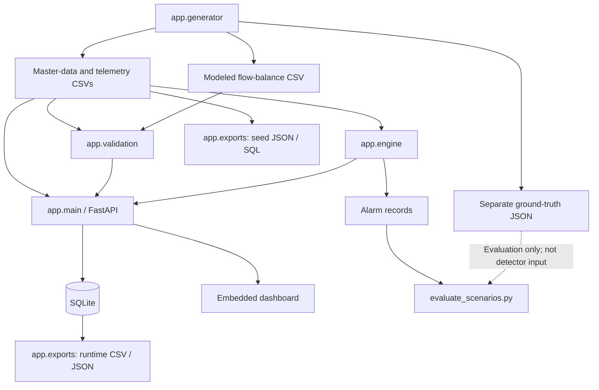

# Architecture and High-Level Design

## 1. Purpose and Scope

IndustrialPulse AI is a local prototype for monitoring synthetic industrial-system data. It combines deterministic data generation, dataset validation, explainable rule-based anomaly detection, a FastAPI service, and SQLite persistence for pump-speed simulations and alarms.

The project demonstrates an end-to-end workflow for generating data, validating it, detecting selected abnormal patterns, exposing results through an API/dashboard, and exporting records. It is **not** a hydraulic network solver, industrial historian, production monitoring platform, or safety system.

## 2. System Architecture and Data Flow



### End-to-end flow

1. **Generate:** `app.generator` creates seeded master data, telemetry, scenario labels, modeled flow-balance records, a validation summary, and a source manifest.
2. **Validate:** `app.validation` checks entity relationships, constraints, modeled balance derivation, and simulation-record traceability.
3. **Detect:** `app.engine` processes telemetry and reference data to produce alarm records. It does not load ground-truth labels.
4. **Serve and persist:** `app.main` exposes validation, telemetry, alarms, and simulation history through FastAPI; relevant run and alarm records are stored in SQLite.
5. **Export:** `app.exports` produces seed-data JSON/SQL and read-only exports of persisted simulation/alarm records.
6. **Evaluate:** `evaluate_scenarios.py` runs detection first, then compares the resulting alarms with separate ground-truth windows. Outcomes are classified as exact-target detections or facility-level proxies.

The separation between detector inputs and ground truth is intentional: labels are used for post-detection evaluation, not to make detection decisions.

## 3. Module Responsibilities

| Module / script | Responsibility |
|---|---|
| `app/generator.py` | Creates seeded master data, sensor metadata, telemetry, eligible scenario injections and separate labels, modeled flow balances, a validation summary, and a source manifest. Scenario windows are included only when their full row-index windows fit within the generated telemetry. |
| `app/validation.py` | Checks generated-table relationships and value constraints, flow-balance provenance and derivation, balance residuals, and simulation-record traceability. |
| `app/engine.py` | Validates and orders telemetry input; detects sensor faults, pressure anomalies, pump degradation, and facility-level flow-depression proxies. It does not read ground-truth files. |
| `evaluate_scenarios.py` | Runs the detector and then compares alarms against exclusive row-index windows in `ground_truth.json`. |
| `app/main.py` | Serves the API and embedded dashboard, initializes SQLite, validates simulation requests and records, and persists simulation runs and alarm rows. |
| `app/exports.py` | Exports generated seed tables to JSON or importable SQLite SQL, and persisted runs/alarms to CSV or JSON. |
| `scripts/reproducibility_check.py` | Generates two datasets in temporary directories and compares returned counts and SHA-256 checksums for each output file. |

## 4. Generated Data and Provenance

The default random seed is `20261022`, and the default telemetry scale is 100,000 rows. Both are configurable through `generate_data.py`. The generator fixes the master counts at 3 facilities, 20 pumps, 30 tanks, and 60 valves. Counts for pipes, sensors, operating modes, and telemetry are derived from the generated tables and reported in the output summary.

The generator writes eight CSV tables for entities/telemetry plus `flow_balances.csv` under `data/generated/`. Scenario labels are stored separately in `ground_truth.json`; `validation_summary.json` records observed counts, validation errors, and flow-balance checks. `source_manifest.json` records the seed, telemetry row count, generator identifier, synthetic-data provenance, and SHA-256 checksums for generated tables, balances, ground truth, and the validation summary. The manifest does not checksum itself or record Python and package versions.

The generator validates that the seed and telemetry count are non-negative integers. A zero or small telemetry scale uses the same generation path; only scenario windows fully contained in the generated row range are labelled.

## 5. Validation and Error Reporting

For readable generated CSVs, `validate_dataset()` returns a structure like this:

```json
{
  "valid": true,
  "errors": [],
  "counts": {},
  "checks": {
    "flow_balance_records_checked": 9,
    "flow_balance_tolerance_lps": 8.0,
    "flow_balances_valid": true,
    "flow_balance_intervals": [
      {
        "balance_id": "BAL-FAC-001-01",
        "valid": true
      }
    ]
  }
}
```

This is an illustrative, abbreviated response: count values and most interval details are omitted. The baseline dataset contains nine modeled flow-balance intervals. `valid` is false when validation errors are collected. Errors are returned as strings; severity levels are not implemented. Missing required files or CSV read failures raise exceptions rather than returning this response structure.

Dataset checks cover required facility/pump/tank/valve counts; primary-key presence and uniqueness; facility foreign keys; component and pipe topology relationships; sensor and telemetry metadata consistency; allowed units, states, roles, and quality values; numeric bounds; timestamp parsing and active `OperatingMode` ranges; duplicate sensor/timestamp telemetry; and tank-capacity constraints. Flow-balance records and simulation records have additional source-record and traceability checks. Negative and boundary cases are covered by `tests/test_validation.py` and `tests/test_api_exports.py`.

## 6. Flow-Balance Model

The baseline `flow_balances.csv` contains nine modeled records: three points for each facility. Pump nominal flows are grouped using sensor metadata roles. At demand factors of 0.50, 0.75, and 1.00, total throughput is calculated as the smaller of the summed inlet and outlet capacities multiplied by the selected factor. Throughput is distributed across pumps on each side in proportion to nominal capacity. Each modeled interval is 60 seconds and assumes zero tank-volume change.

The validator recalculates the source capacities and modeled flows from the Pump and Sensor CSVs, then checks the residual:

`sum(inlet flow in L/s) - sum(outlet flow in L/s) - (tank volume change in L / interval duration in seconds)`

An absolute residual of at most 8 L/s is accepted. These are constructed steady-state values, not measurements from telemetry. They do not establish physical conservation or hydraulic accuracy in a real system. See [Simulation Assumptions](simulation_assumptions.md) for further detail.

## 7. Detection and Scenario Evaluation

The detector uses telemetry features and nominal pump values. It sorts timestamps, rejects malformed required rows, excludes telemetry marked `suspect` from process rules, and masks identified sensor-fault windows while screening pressure or flow anomalies. Current thresholds are fixed in the rule engine rather than externally configurable.

The rules cover stuck or negative sensor readings, sustained high facility pressure, low pump flow, and facility-wide normalized flow depression. Pump-degradation evaluation can match a Pump target exactly. Sensor-fault evaluation matches the exact Sensor target and its monitored component; the alarm's `component_id` identifies that monitored component. Leak-like flow depression is attributed to a Facility. A blockage scenario is represented through facility pressure and cannot be localized to an individual Pipe by the current detector.

Evaluation counts describe only the current synthetic scenario set. They are not precision, recall, F1, or evidence of performance on real industrial data. In the current baseline, two outcomes are exact-target detections and two are facility-level proxies; the proxy outcomes should not be interpreted as exact fault localization.

## 8. API, Simulation, and Persistence

FastAPI serves the dashboard at `/`, interactive API documentation at `/docs`, and the following endpoints:

| Method | Route | Behaviour |
|---|---|---|
| `GET` | `/api/summary` | Validates generated data and returns counts and validation results. |
| `GET` | `/api/telemetry` | Returns a bounded sample of 1–5,000 telemetry rows. |
| `GET` | `/api/alarms` | Runs detection and inserts previously unseen alarm IDs into SQLite. |
| `POST` | `/api/simulations` | Validates and records a pump-only speed estimate. |
| `GET` | `/api/simulations` | Reads stored simulation history. |

### Pump-speed simulation

Simulation estimates use the affinity approximations:

- `Q₂ / Q₁ ≈ N₂ / N₁`
- `H₂ / H₁ ≈ (N₂ / N₁)²`

These formulas estimate changes in flow and head from speed changes for a pump; they do not solve the surrounding network.

Each run receives a UUID-based identifier and stores the pump/facility references, speed, seed, model version, assumptions, configuration JSON and hash, status, timestamp, and output JSON. Fresh databases apply primary-key, foreign-key, check, and JSON constraints. A compatibility migration adds and backfills `pump_id` on legacy run rows without dropping existing run history.

SQLite tables are `facilities`, `pumps`, `components`, `simulation_runs`, and `alarms`. Alarm rows may optionally reference a simulation run. Runtime alarm records do not persist the detector's sensor IDs or time windows. Alarm lifecycle transitions, acknowledgement, and resolution workflows are not implemented. The database is not an event-sourcing system or immutable audit store.

## 9. Exports

Seed JSON and SQL are generated from validated CSV inputs and contain the eight entity/telemetry tables; modeled flow balances are exported separately. SQL output includes relational and check constraints. The export is tested by importing it into a fresh SQLite database and checking row counts and foreign-key integrity.

Simulation and alarm exports are read-only views of existing SQLite records: `simulation_runs.csv`, `simulation_runs.json`, `alarms.csv`, and `alarms.json`. They do not create or modify simulation history. See the [README export commands](../README.md#exports).

## 10. Reproducibility

`scripts/reproducibility_check.py` runs generation twice in separate temporary directories with the same seed and scale, then compares reported counts and SHA-256 hashes of the output files. Matching results support deterministic generation for that configuration and environment. Because the manifest does not capture Python/package versions, the check does not by itself establish reproducibility across different runtime environments.

## 11. Limitations and Non-Goals

- All baseline and scenario data is synthetic; no operational telemetry is included.
- Telemetry rows are assigned one sensor at a time and are not synchronized boundary measurements suitable for deriving network mass balance.
- Modeled flow intervals are derived from nominal capacities and a zero-storage-change assumption, not hydraulic observations.
- The generated pipe chain represents references and topology; it is not a solved flow network.
- Detection thresholds are illustrative, and proxy alarms do not prove a particular fault or its physical location.
- Pump-speed calculations are approximations and do not model full network interactions.
- The local API/database demonstration does not provide production authentication, deployment hardening, backup/recovery, or safety controls.

## 12. Summary

IndustrialPulse AI demonstrates a traceable local workflow from deterministic synthetic-data generation through validation, rule-based detection, API access, SQLite persistence, export, and post-detection scenario evaluation. Its main strengths are explicit data provenance, repeatable testable workflows, and clear separation between detection and evaluation labels. Its results remain limited to the modeled synthetic environment and should not be interpreted as validated industrial diagnostics.
